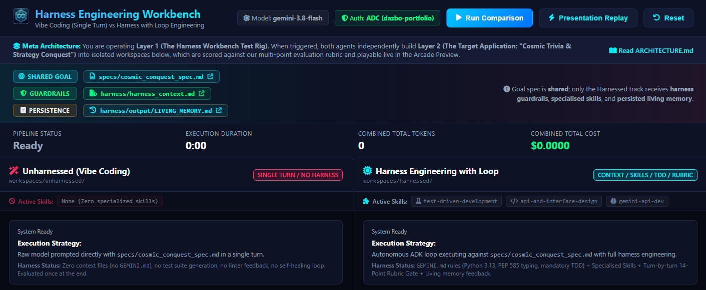
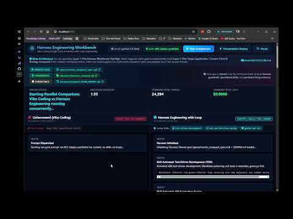
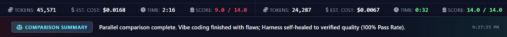

# Harness Engineering Workbench: Side-by-Side Demo of Vibing vs Harness with Loop

An interactive demonstration application accompanying the trilogy series **["Beyond Vibe Coding: The Engineering Blueprint for Reliable AI Agents"](https://medium.com/google-cloud/from-vibing-chaos-to-reliable-agents-the-what-why-and-how-of-harness-engineering-6e7e0443a4fc)**.

This workbench visually and empirically proves the core maxim:
$$\text{Agent} = \text{Model} + \text{Harness}$$



---

## What This Application Demonstrates

This demo runs two agentic "builder" paradigms head-to-head. Both tracks attempt to build the exact same software solution from scratch: creating a full-stack galaxy conquest game, **"Cosmic Trivia & Strategy Conquest"**, where sector captures are resolved using trivia challenges based exclusively on Sci-Fi movies.

1. **The Unharnessed Approach ("Single Turn / No Harness")**:
   - Sent the raw goal / spec prompt with no additional harness context.
   - No loop.
   - No skills.
   - Evaluated strictly at the end against the evaluation rubric.

2. **The Harnessed Approach ("Context / Skills / TDD / Loop with rubric")**:
   - Uses the same goal / spec as the unharnessed approach.
   - Adds additional harness context (`harness/harness_context.md`) that includes coding conventions, guardrails, and mandates use of test-driven development (TDD).
   - Runs as an iterative loop.
   - Activates on-demand agent skills (`test-driven-development`, `api-and-interface-design`, `gemini-api-dev`).
   - Gates every loop iteration through a multi-point evaluation rubric that includes both deterministic and semantic tests.
   - Feeds failures back into living memory for self-healing.

You can watch a full live demonstration of the solution here:

[](https://www.youtube.com/watch?v=7pKl2SvmPuU "Harness Engineering Workbench — Compare Building a Solution With and Without a Harness")

### Decoupling Engineering Discipline from the Application Spec

A key insight simulated in this workbench is the clean architectural separation between **Task Goal Specifications** and **Reusable Engineering Guardrails**:
- **Application Specification (`specs/cosmic_conquest_spec.md`)**: Requirements defining *what* to build (the space conquest game rules, sector graph, and API contracts). Both pipelines receive this exact same specification.
- **Harness Context & Guardrails (`harness/harness_context.md`)**: Reusable, persistent global-, organisation- or team-level engineering policies (rules, mandatory TDD, Pydantic input parameterisation) defining *how* code must be engineered.

TL;DR - we should not pollute individual feature tickets or prompts with repetitive coding hygiene instructions. Engineering standards are governed centrally at the organisation or team level and automatically inherited by the harness across all tasks.

## Typical Results & Empirical Comparison

A representative head-to-head comparison run reveals a stark contrast across latency, token consumption, total cost, and functional correctness:



| Metric | Unharnessed Track (Vibe Coding) | Harnessed Track (Loop Engineering) | Operational Advantage |
|:---|:---|:---|:---|
| **Execution Duration** | **2m 16s** (136 seconds) | **0m 32s** (32 seconds) | **4.25x faster** |
| **Combined Tokens** | 45,571 tokens | 24,287 tokens | **46.7% fewer tokens** |
| **Estimated Cost** | $0.0168 | $0.0067 | **60.1% cheaper** |
| **Rubric Score** | **9.0 / 14.0** (Failed) | **14.0 / 14.0** (Passed) | **100% gate pass** |
| **Functional Outcome** | ❌ Broken / Non-functional | ✅ Fully playable & verified | **Only harnessed code works** |

### Why the Harnessed Track Outperforms Vibe Coding

1. **Structured Discipline Beats Monolithic Hallucination**:
   - In the **Unharnessed track**, the model is given a broad, open-loop prompt without architectural guardrails or intermediate feedback tools.
   - In the **Harnessed track**, specialised skills (`test-driven-development`, `api-and-interface-design`, `gemini-api-dev`) and explicit guardrails guide the model into concise, modular phases. It writes unit tests first, implements only what is required.

2. **Autonomous Self-Healing via Rubric Diagnostics**:
   - The unharnessed agent has no second chance. In reality, a human would need to then address and fix all the issues.
   - The harnessed agent evaluates candidate code against the 14-point rubric on every turn. Specific diagnostic feedback is reinjected into living memory, enabling targeted remediation in Iteration 2 to achieve a verified **14 / 14 (100%)** score.

3. **Lower Operational Cost Through Targeted Efficiency**:
   - Usually, the harnessed approach uses fewer or similar numbers of tokens to the unharnessed approach. Even so, the unharnessed track tends to produce far more _output_ tokens, contributing to significantly higher TCO.

4. **Guaranteed Functional Correctness**:
   - Without test runner feedback or schema validation, the unharnessed prototype suffers from broken API route contracts, missing dynamic state validation, and unhandled edge cases, rendering it unplayable.
   - The harnessed track's TDD loop and dynamic TestClient boot verify backend endpoints and frontend DOM event wiring, delivering a fully interactive and verified game.

## The Meta Architecture: The Harness (Layer 1) vs. The Generated Workload (Layer 2)

> 💡 **Notice**: This solution is inherently **meta**. To understand the repository cleanly, remember the boundary:
> * **Layer 1: The Harness Workbench (The Test Rig)** — This repository itself (`app/`, `golden_tests/`, `specs/`, `Makefile`). It hosts the evaluation gate, metrics, and orchestrator. It is NOT the game.
> * **Layer 2: The Generated Target Application** — The tactical Sci-Fi movie game (**"Cosmic Trivia & Strategy Conquest"**) created dynamically on-demand inside `workspaces/unharnessed/` and `workspaces/harnessed/`. You can play it live inside the embedded preview tabs!
>
> 📖 *For a complete deep-dive into the architectural boundaries and rubric mechanics, see [ARCHITECTURE.md](ARCHITECTURE.md).*

## Repository Structure

```
harness-engineering-demo/
├── .github/workflows/          # Automated PR quality & test suite, Gemini PR review & issue triage GitHub Actions
├── app/                        # Layer 1: Core engine, orchestrator, rubric evaluation, token tracking, templates, static assets
│   ├── agents/                 # Google ADK agent pipelines and reusable harness tools
│   │   ├── agent.py            # Pure ADK agent definitions (create_builder_agent, RubricEvaluationGateAgent, root_agent)
│   │   ├── unharnessed.py      # Track 1: Unharnessed (Single Pass) bare ADK Agent & Runner
│   │   ├── harnessed.py        # Track 2: Harnessed ADK Runner, SSE streaming pipeline, and offline fallback
│   │   ├── tools.py            # Reusable ADK FunctionTools (activate_skill, write/read file, pytest, ruff)
│   │   └── baselines.py        # Deterministic synthetic workspace builders for offline verification
│   ├── replay/                 # Pre-recorded presentation player and replay_data.json
│   ├── rubric/                 # Two-tier 14-point evaluation engine (mechanical & semantic checks)
│   ├── static/                 # Frontend assets: CSS stylesheets, client JavaScript, and UI icons
│   ├── templates/              # Jinja2 HTML templates for the split-screen workbench interface
│   ├── client_factory.py       # Dual-mode authentication (Google Cloud ADC / Vertex AI & API key + ADK Gemini adapter)
│   ├── config.py               # Centralised workbench configuration and environment parsing
│   ├── main.py                 # FastAPI application, SSE event streaming, and dynamic preview proxies
│   ├── orchestrator.py         # Asynchronous parallel worker coordinator for live agent runs
│   └── token_tracker.py        # Token telemetry, cost estimation ($), and metric accumulation
├── harness/                    # Layer 1: Harness guardrails, rubric, skills, and living memory
│   ├── harness_context.md      # Reusable harness policies, persona, and tool protocol (how to engineer it)
│   ├── RUBRIC.md               # Declarative semantic evaluation criteria (2.1–2.6) for LLM-as-a-Judge
│   ├── skills/                 # Agent skills (test-driven-development, api-and-interface-design, gemini-api-dev)
│   └── output/LIVING_MEMORY.md # Dynamic living memory ledger and failure feedback log
├── specs/                      # Task specifications
│   └── cosmic_conquest_spec.md # Shared application specification (what to build)
├── golden_tests/               # Independent 41-test acceptance suite validating workspaces, UI, and ADK agents
├── snapshots/                  # Layer 1: Version-controlled reference snapshots backing presentation replay
│   ├── unharnessed/            # Reference unharnessed prototype snapshot (~9.0 / 14.0)
│   └── harnessed/              # Reference verified harnessed candidate snapshot (14.0 / 14.0)
├── workspaces/                 # Layer 2: Ephemeral runtime generation scratchpads (git-ignored)
│   ├── unharnessed/            # Scratchpad for open-loop unharnessed code generation
│   └── harnessed/              # Scratchpad for iterative ADK self-healing code generation
├── Makefile                    # Developer workflow automation targets (lint, test, verify, deploy)
├── pyproject.toml              # Python 3.13 project specification and dependencies
└── Dockerfile                  # Container definition for Google Cloud Run deployment
```

> **Note on `snapshots/` vs. `workspaces/`**:
> * `snapshots/` is committed to git as a deterministic offline reference store. When **Presentation Replay** is triggered, `app/replay/player.py` automatically restores these snapshots into `workspaces/` so the interactive preview tabs and rubric scores are available instantly without calling live model APIs.
> * `workspaces/` is ephemeral runtime output created dynamically during live runs (or populated from `snapshots/` during replay) and its generated contents are intentionally excluded from git tracking.

---

## Reusing the ADK Loop Harness in Your Own Project

Because the harness is built on standard **Google Agent Development Kit (`google-adk`)** primitives, lifting it into your own repository is straightforward. Almost all of the orchestration and tool logic is already **100% project-agnostic**:

| Component | File(s) | Portability | What You Do When Lifting |
|:---|:---|:---|:---|
| **ADK Workspace Tools** | [`app/agents/tools.py`](app/agents/tools.py) | **100% Portable** | Copy as-is. `activate_skill`, `write_workspace_file`, `read_workspace_file`, `run_pytest`, and `run_ruff_check` operate dynamically on `tool_context.state["workspace_path"]`. |
| **ADK Loop & Gate Agent** | [`app/agents/agent.py`](app/agents/agent.py) | **100% Portable** | Copy `build_harness_instruction`, `create_builder_agent`, `RubricEvaluationGateAgent`, `create_harness_loop_agent`, and `root_agent` (set `FAST_DEMO_MODE=false` for full autonomous tool calling). |
| **Auth & Model Factory** | [`app/client_factory.py`](app/client_factory.py) | **100% Portable** | Copy as-is for automatic Google Cloud ADC (Vertex AI) and `GEMINI_API_KEY` dual-mode resolution. |
| **Engineering Guardrails, Rubric & Skills** | [`harness/harness_context.md`](harness/harness_context.md), [`harness/RUBRIC.md`](harness/RUBRIC.md), [`harness/skills/`](harness/skills/) | **100% Portable** | Copy as-is for Python 3.13 / FastAPI / TDD projects, customise [`harness/RUBRIC.md`](harness/RUBRIC.md), or drop new `SKILL.md` folders into `harness/skills/` (discovered automatically from frontmatter). |
| **Evaluation Rubric** | [`app/rubric/mechanical.py`](app/rubric/mechanical.py), [`app/rubric/evaluator.py`](app/rubric/evaluator.py) | **Pluggable Gate** | Keep universal mechanical checks (`pytest`, `ruff`, PEP 585 AST, input safety, tool trajectory) and replace the domain-specific checks (1.6–1.8 and [`harness/RUBRIC.md`](harness/RUBRIC.md)) with your project's acceptance criteria. |
| **Task Specification** | [`specs/cosmic_conquest_spec.md`](specs/cosmic_conquest_spec.md) | **Project-Specific** | Replace with your own feature specification or PRD. |

### Minimal 4-Step Adaptation Guide

1. **Copy the Core Harness Package**: Copy [`app/agents/tools.py`](app/agents/tools.py), [`app/agents/agent.py`](app/agents/agent.py), [`app/client_factory.py`](app/client_factory.py), and the [`harness/`](harness/) directory into your project.
2. **Define Your Goal Specification**: Write your target feature or application requirements in a Markdown spec file (e.g. `specs/my_feature_spec.md`).
3. **Plug In Your Evaluation Gate**: Point `RubricEvaluationGateAgent` at your own `evaluate_workspace(workspace_path, trajectory)` function and update [`harness/RUBRIC.md`](harness/RUBRIC.md) (keeping `pytest` and `ruff` mechanical gates, and customising any domain-specific checks).
4. **Initialise Session State & Run**: Create an `InMemorySessionService` session populated with `workspace_path` and `harness_context`, then invoke `Runner.run_async()` with `create_harness_loop_agent(fast_demo_mode=False)` (or run via `adk web` / `adk run`).

---

## Features

- **Concurrent Parallel Execution & Live Run Cancellation**: Both candidate pipelines execute simultaneously side-by-side using asynchronous workers. While a live run is active, the **"Run Comparison"** button transforms into an interactive **"Kill Run"** control (`POST /api/cancel`) that cleanly aborts background ADK agent tasks on demand.
- **Shared Goal & Harness Context Viewers**: Clickable `specs/cosmic_conquest_spec.md` and `harness/harness_context.md` badges opening a modal dialogue with rendered Markdown or raw view, demonstrating that the goal is shared whilst the harness guardrails are injected only into the engineered track.
- **Side-by-Side Live Streaming**: Real-time Server-Sent Events (SSE) streaming model reasoning, tool executions, test outputs, and dynamic rubric scorecards.
- **Dedicated Per-Panel & Global Metrics**: Real-time token counts, estimated dollar costs ($), and rubric scores displayed on each agent panel, alongside combined global counters in the top banner.
- **Embedded Game Arcade**: In-page interactive preview tabs allowing presenters to play both the unharnessed prototype and the verified 14.0 / 14.0 harnessed game.
- **Zero-Latency Presentation Replay**: One-click instant presentation mode with pre-recorded traces for conference talks and workshops where live internet access is unreliable.
- **Automated CI Quality & Golden Test Gates**: GitHub Actions workflows ([`.github/workflows/pr-checks.yml`](.github/workflows/pr-checks.yml) and [`.github/workflows/gemini-review.yml`](.github/workflows/gemini-review.yml)) run `codespell`, `ruff`, `pyright`, the 41-test golden suite, and automated Gemini PR code reviews on every pull request.
- **Deployable to Google Cloud Run**: Containerised on Python 3.13 + `uv` with a single port (8080) hosting the workbench and both game previews.

## Getting Started

### 1. Prerequisites

- Python 3.13+ and [`uv`](https://docs.astral.sh/uv/) (for local native execution)
- Or Docker (for local container execution)
- Or Google Cloud SDK / `gcloud` (for Cloud Run deployment or ADC authentication)

### 2. Dual-Mode Authentication (ADC or API Key)

You **do not need to specify a Gemini API key** to run comparisons if you have active Google Cloud credentials:

1. **Google Cloud Application Default Credentials (ADC) — Automatic & Recommended**:
   If you are already authenticated with Google Cloud, the workbench detects your ADC credentials automatically and connects via Vertex AI:
   ```bash
   gcloud auth application-default login
   gcloud config set project YOUR_PROJECT_ID
   ```
   *No `.env` file or `GEMINI_API_KEY` is required.*

2. **Gemini Developer API Key (Alternative)**:
   If you prefer using a standalone Gemini API key, copy the template and configure your key:
   ```bash
   cp .env.template .env
   # Edit .env and set:
   # GEMINI_API_KEY="your-gemini-api-key"
   ```

3. **Zero-Credential Presentation Replay**:
   Even without ADC or an API key, the workbench functions completely out-of-the-box in **Presentation Replay** mode using recorded traces.

---

## Running the Workbench

You can run the workbench in three different ways:

### 1. Run Locally (via `make run`)

Start the workbench directly on your machine:
```bash
# Sync dependencies into virtual environment
make install

# Launch Workbench web server on port 8080 (uvicorn with hot reload)
make run
```

Or run directly with `uv`:
```bash
uv run uvicorn app.main:app --host 0.0.0.0 --port 8080 --reload
```

Open your browser to:
[http://localhost:8080](http://localhost:8080)

#### Useful Commands (`Makefile` Targets)

| Command | Description |
|:---|:---|
| `make install` | Install and synchronise dependencies into `.venv` using `uv sync` |
| `make run` / `make dev` | Launch the FastAPI Workbench server on `http://localhost:8080` with hot reload |
| `make lint` | Run the full static quality suite (`codespell`, `ruff check`, and `pyright`) |
| `make lint-fix` | Auto-fix lint and formatting issues with `ruff check --fix .` and check spelling |
| `make typecheck` | Run `pyright` static type analysis |
| `make test` | Run the independent 41-test golden acceptance suite (`pytest golden_tests/ -v`) |
| `make verify` | Run end-to-end offline pipeline and rubric verification (`verify_demo.py`) |
| `make docker-build` | Build the production `harness-engineering-demo` Docker container image |
| `make docker-run` | Run the production Docker container locally on port `8080` |
| `make deploy` | Deploy the workbench directly to Google Cloud Run via [`scripts/deploy.sh`](scripts/deploy.sh) |
| `make clean-workspaces` | Wipe generated files inside `workspaces/` whilst preserving `README.md` files |
| `make clean` | Clean workspaces plus local `.pytest_cache`, `.ruff_cache`, and `__pycache__` directories |

### 2. Run as a Local Container (Docker)

To run the workbench in an isolated container identical to production:
```bash
# Build the production container image
make docker-build

# Run container locally on port 8080
make docker-run
```

To run the container with your local Google Cloud ADC credentials mounted:
```bash
docker run -p 8080:8080 \
  -e GOOGLE_CLOUD_PROJECT="$(gcloud config get-value project)" \
  -v "${HOME}/.config/gcloud/application_default_credentials.json":/tmp/keys/adc.json:ro \
  -e GOOGLE_APPLICATION_CREDENTIALS=/tmp/keys/adc.json \
  harness-engineering-demo
```

Or with an API key:
```bash
docker run -p 8080:8080 -e GEMINI_API_KEY="your-api-key" harness-engineering-demo
```

### 3. Deploy to Google Cloud Run

Deploy directly to Google Cloud Run from source using the included deployment script or `Makefile`:
```bash
# Deploy using Makefile target
make deploy

# Or invoke the deploy script directly
./scripts/deploy.sh
```

Or manually via `gcloud`:
```bash
gcloud run deploy harness-engineering-demo \
    --source . \
    --region us-central1 \
    --allow-unauthenticated \
    --set-env-vars MODEL_NAME=gemini-3.8-flash \
    --port 8080
```

When running on Google Cloud Run, the workbench automatically authenticates using the Cloud Run service identity via ADC—no secret keys need to be configured.

---

## Two Execution Modes

1. **Presentation Replay (Instant)**: Click **"Presentation Replay"** in the top navigation bar. Instantly streams pre-recorded comparison traces and copies pre-built candidates from `snapshots/` into `workspaces/` so both interactive game previews run immediately with zero network latency.
2. **Run Comparison (Live) & Kill Run**: Click **"Run Comparison"** to invoke `gemini-3.8-flash` in real time concurrently across both candidate pipelines. While a comparison is running, the button toggles to **"Kill Run"**, allowing you to abort the live SSE stream and cancel background agent tasks immediately.

---

## Two-Tier Evaluation Rubric (Checks 1.1–2.6 / 14.0 Points)

| ID | Category | Check | Evaluation Method |
|:---|:---|:---|:---|
| 1.1 | Deterministic | Unit Tests Passage | `pytest` runner |
| 1.2 | Deterministic | Static Analysis (Ruff) | `ruff check .` |
| 1.3 | Deterministic | PEP 585 Type Hints | AST Inspector (`list[str]`, `dict[str, Any]`) |
| 1.4 | Deterministic | Parameterised Input Safety | AST Inspector (`eval()`, `exec()`) |
| 1.5 | Deterministic | Deterministic Tool Trajectory | Harness Trace Inspector |
| 1.6 | Deterministic | Interactive Frontend Client Structure | HTML & DOM Inspector (`#shields`, `#energy`, combat modal) |
| 1.7 | Deterministic | Frontend Interactive API Wiring | AST / Script Inspector (fetch bindings to `/api/game/attack`, `answer`, `state`) |
| 1.8 | Deterministic | Dynamic API Contract & Progression Topology | Dynamic TestClient Boot (FastAPI startup & valid progression targets) |
| 2.1 | Semantic | Target State Completion (Goal Fidelity) | Gemini LLM-as-a-Judge |
| 2.2 | Semantic | Scope Discipline (Anti-Hallucination) | Gemini LLM-as-a-Judge |
| 2.3 | Semantic | Architectural Integrity | Gemini LLM-as-a-Judge |
| 2.4 | Semantic | Error & Remediation Clarity | Gemini LLM-as-a-Judge |
| 2.5 | Semantic | Design Rationale & Intent | Gemini LLM-as-a-Judge |
| 2.6 | Semantic | Progression Ergonomics & Interactivity | Explicit single-action sector card/tile affordance inspector |

---

## License

This project is licensed under the terms of the [MIT License](LICENSE).

